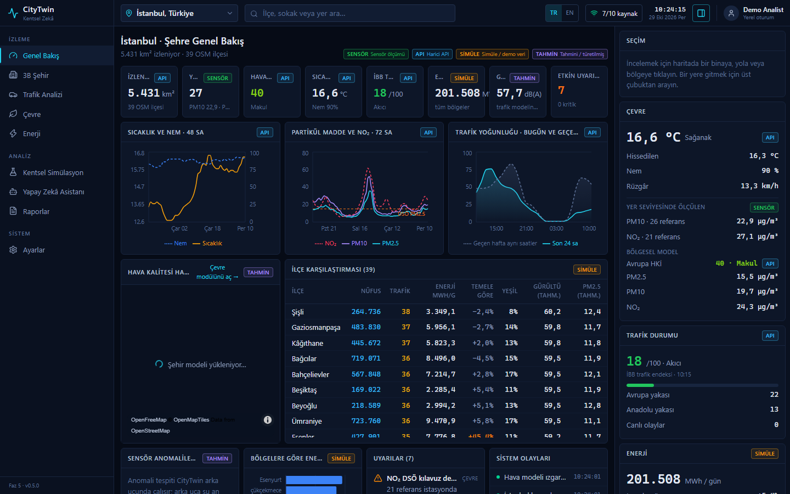
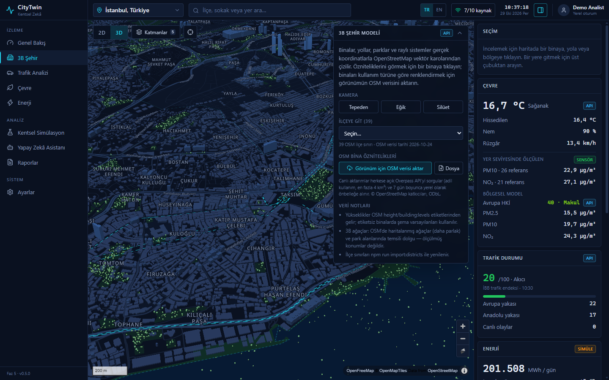
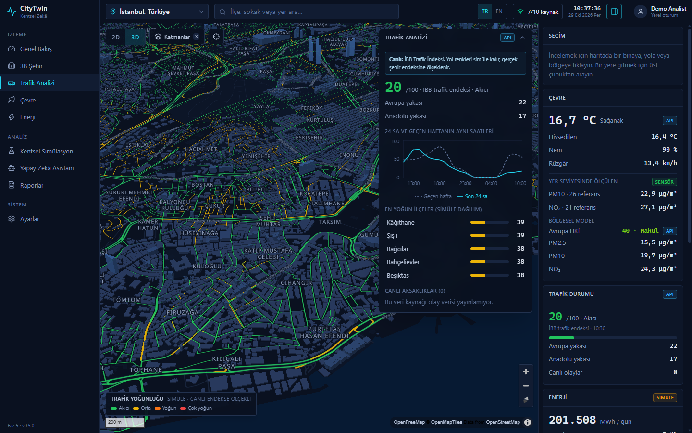

# CityTwin — AI-Powered Smart City Digital Twin

CityTwin is an urban intelligence platform. It combines geospatial data, environmental feeds, traffic and energy analysis with AI-assisted insight and what-if simulation.

**Status: Phase 5.** It contains the frontend, the 2D/3D map, the OSM pipeline and Three.js detail layers, live traffic and ground-station air data where public feeds exist, and an optional FastAPI + PostGIS backend that serves districts, caches upstream feeds and pushes sensor updates over WebSocket. The backend also runs ML anomaly detection on the measured readings and hosts CityTwin AI, a Claude agent that answers questions with tools over that data.

## Screenshots



| 3D city model | Traffic analysis |
|---|---|
|  |  |

## Quick start

```bash
npm install
npm run dev                 # http://localhost:5173
npm run build               # type-check + production bundle in dist/
npm run import:districts    # refresh OSM district boundaries (all cities, or pass ids: berlin london)
```

Requires Node.js 22.6+ (the pipeline runs TypeScript through Node's built-in type stripping). No API keys are needed. All data sources are public and keyless.

Optional: copy `.env.example` to `.env.local` and set `OPENAQ_API_KEY` (free at explore.openaq.org) to add OpenAQ ground stations for every city.

The frontend works on its own ("direct mode"). The backend below is optional; when it is running, the frontend detects it and switches to it.

## Phase 4: backend (FastAPI + PostGIS)

Requires Python 3.11+ and PostgreSQL 17 with PostGIS 3. On Windows without admin rights, `backend/scripts/db.ps1` runs a portable cluster from `backend/.pg` (the EDB PostgreSQL binaries and the OSGeo PostGIS bundle are extracted there; the folder is git-ignored).

```powershell
pwsh backend/scripts/db.ps1 setup          # once: initdb on 127.0.0.1:54329, create db + PostGIS
pwsh backend/scripts/db.ps1 start          # also: stop | status
pip install -e "backend[dev]"              # in a Python env (we use a Miniforge env named citytwin)
cd backend
python -m app.cli migrate                  # schema (also runs on API start)
python -m app.cli load-districts           # public/data/districts/*.geojson → PostGIS (also on start; --force to reload)
python -m app.cli anomalies [city]         # one anomaly scan of the stored readings (also runs after every poll)
python -m uvicorn app.main:app --port 8000 # API + WebSocket; serves dist/ too if built
python -m pytest -q                        # tests against the local database; no outbound network, no Claude calls
```

**Desktop app (Windows):** `scripts/CityTwin.ps1` starts the database and the API (serving `dist/`), then opens CityTwin in an Edge app window; `scripts/CityTwin-Stop.ps1` stops both, after running `scripts/backup.ps1`, which mirrors the project (without `node_modules`, `dist` and `backend/.pg`) to the backup drive and saves a `pg_dump` of the database there; pass `-Dest` to change the target. Desktop shortcuts point at these scripts, with `scripts/citytwin.ico` (regenerate with `scripts/make-icon.ps1`). API logs go to `logs/`. Set `CITYTWIN_PYTHON` if the backend's Python isn't the Miniforge env `citytwin`.

With `npm run dev` running as well, Vite forwards `/api` and `/ws` to the backend (`CITYTWIN_BACKEND`, default `http://127.0.0.1:8000`). After `npm run build`, the backend alone serves the whole app at http://localhost:8000.

What the backend adds:

- **Districts from PostGIS**: the pipeline output is loaded into a GiST-indexed `MultiPolygon` table. Areas use geodesic (geography) maths, and `GET /api/v1/cities/{id}/districts/at?lon=&lat=` finds the district at a point.
- **Cached proxies**: İBB traffic (60 s), İBB air (10 min) and OpenAQ (5 min) are cached in memory. Overpass building imports are cached for 7 days in Postgres, with fallback across four mirrors. The OpenAQ key is read from `.env.local` by the backend and never reaches the browser.
- **Live sensors**: a poller fetches İBB, Sensor.Community and (with a key) OpenAQ for every city every 10 minutes, stores the readings and pushes each new snapshot to `/ws/sensors?city=`. While the socket is open, the frontend stops polling station feeds.
- **Fallback**: if `/api/v1/health` doesn't answer, the frontend uses the Phase 3 direct mode. **Settings → Data sources & provenance** lists the backend and WebSocket feeds when backend mode is active.

Endpoint reference: [docs/ARCHITECTURE.md §5](docs/ARCHITECTURE.md), or the generated OpenAPI docs at http://localhost:8000/docs.

## Phase 5: CityTwin AI and anomaly detection

Both run on the backend.

- **Anomaly detection (ML)**: after every sensor poll, each station's latest hourly value is scored with three methods. A robust z-score against its own last 48 h, a robust z-score against its nearest neighbours, and an IsolationForest across the city's stations. Flags are *spike*, *local hotspot*, *sensor fault* (PM2.5 > PM10, flat-lined, implausible) and *city-wide episode*. They appear under **Overview → Sensor anomalies**, in the Environment panel and as alerts, labelled `ESTIMATE`: the readings are real, the judgement is statistical. Low-cost sensors are never rated critical on their own.
- **CityTwin AI**: set `ANTHROPIC_API_KEY` in `.env.local` and restart the backend. The assistant page then switches from the rule-based engine to Claude (`claude-opus-5-5`, adaptive thinking, effort `medium`). Claude answers by calling ten read-only tools: city overview, districts, district at a point, stations, air by district (PostGIS join), air history, station history, anomalies, weather/CAMS and live traffic. Tool calls stream into the chat as they happen, and every answer lists the providers behind its figures. The key stays on the backend. Without a key, the rule-based assistant is used and **Settings** says so.
- Optional settings: `AI_MODEL`, `AI_EFFORT` (`low`…`max`) and `AI_MAX_STEPS` (tool rounds per question, default 8).

## Phase 3 additions: real feeds

| City | Live traffic | Ground air stations |
|---|---|---|
| Istanbul | İBB traffic index + 8-day history | 28 İBB reference stations |
| London | TfL corridor status + live disruptions | Sensor.Community (low-cost) |
| New York | NYC DOT measured link speeds | OpenAQ (key) |
| Berlin | — (simulated) | Sensor.Community (low-cost) |
| Ankara, İzmir, Tekirdağ, Edirne, Bursa, Kocaeli, Antalya | — (simulated) | Sensor.Community where sensors exist, OpenAQ (key) |

Measured values carry a `SENSOR` badge. Values CityTwin derives from a live feed carry `ESTIMATE`, with the method in the tooltip. Anything without a live source stays `SIMULATED`. Some providers lack usable CORS headers or need a secret, so they go through same-origin proxies in `npm run dev` and `npm run preview`. See [docs/ARCHITECTURE.md §4](docs/ARCHITECTURE.md).

## Phase 2 additions

- **Real districts:** OSM administrative boundaries for every city (Istanbul 39, Ankara 25, İzmir 30, Tekirdağ 11, Edirne 9, Bursa 17, Kocaeli 12, Antalya 19, Berlin 12, London 32, New York 5). They replace the hex grid as analysis zones, with real area and the OSM population tag where present. They ship in `public/data/districts/`.
- **Building attributes:** in **3D City → Import OSM data for view**, the visible area (≤ 4 km²) is fetched from Overpass and cached in IndexedDB. Buildings can then be coloured by use. Clicking one shows its name, use, address, levels, tagged height, construction year, roof, material and a link to openstreetmap.org. **File** loads `.osm` XML or overpass-turbo GeoJSON.
- **Three.js layers** (MapLibre custom layer): instanced 3D trees, 3D district columns (population / PM2.5 / energy / traffic) and animated incident markers.

## Data honesty

Every value in the UI carries a provenance badge:

| Badge | Meaning | Phase 1 sources |
|---|---|---|
| `SENSOR` | Physical measurement | none connected yet |
| `API` | External API (may itself be model output) | Open-Meteo weather, Open-Meteo air quality (CAMS model), OpenStreetMap |
| `SIMULATED` | Synthetic demo data | traffic congestion, energy consumption, zone demographics, incidents |
| `ESTIMATE` | Derived by CityTwin with a stated formula | noise, building floors/energy, zone PM2.5 interpolation, scenario outputs |

Hover any badge to see the provider and method. **Settings → Show simulated data** hides all synthetic values.

## Features (Phase 1)

- **Overview**: KPIs, 48 h weather, 72 h air-quality history with the WHO reference line, traffic today vs last week, district comparison table, energy by zone, alerts and system events.
- **3D City**: OSM buildings extruded by height, 2D/3D toggle, camera presets, click a building for its height, footprint and estimated floor area and energy use.
- **Traffic Intelligence**: congestion overlay on real OSM road geometry (simulated values), click a road to inspect it, bottleneck zones, closures and incidents, historical comparison.
- **Environment**: AQI zone choropleth and regional heatmap from the CAMS model grid, pollutants (PM2.5, PM10, NO₂, O₃, CO, CO₂), estimated noise.
- **Energy**: zone consumption vs baseline, anomaly detection (>20 % above baseline), demand curve, rooftop solar potential.
- **Urban Simulation**: road closure, new route, greening, efficiency and solar scenarios with before/after views and saved-scenario comparison. Every coefficient is listed on the page.
- **AI Assistant**: rule-based, data-grounded Q&A that cites a source for every value. It refuses rather than guesses.
- **Reports**: Markdown situation report (download, or print to PDF).
- **Search**: geocoding by place name via Photon (OSM).
- **Settings**: language (Türkçe / English, also the TR/EN switch in the top bar), refresh interval, temperature unit, default map mode, simulated-data toggle, feed status.
- **Languages**: the UI defaults to Turkish. `src/i18n/` keys the dictionary by the English text (`t('Air quality')`) and falls back to English for anything untranslated; `TR_PATTERNS` covers strings with numbers in them, such as backend anomaly explanations. In `npm run dev`, `window.__i18nMissing` lists strings that went through `t()` without a translation.

See [docs/ARCHITECTURE.md](docs/ARCHITECTURE.md) for the design and the roadmap for Phases 2–7.

## License

[MIT](LICENSE) © 2026 Eren Tyto
